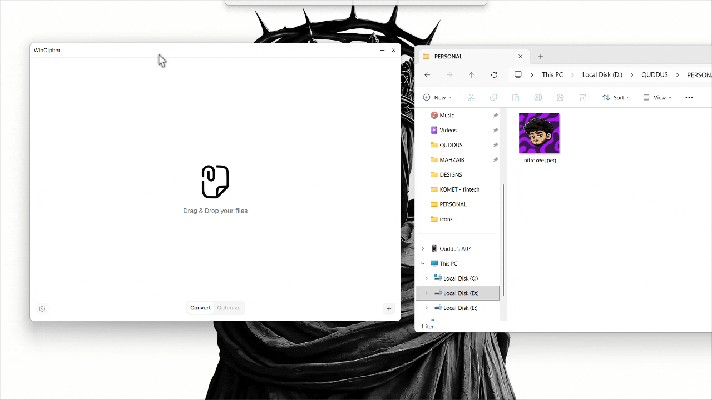

<p align="center">
  
</p>

<h1 align="center">WinCipher</h1>

<p align="center">
  <strong>A minimal Windows app that converts files into other formats quickly, privately, and entirely offline.</strong>
</p>

<p align="center">
  Just install, drop your files in, and convert with WinCipher.
</p>

<p align="center">
  <a href="https://github.com/quddus-larik/WinCipher/releases">
    
  </a>
  
  
  
</p>

<p align="center">
  
  
  
  
</p>

---


## Why WinCipher?

Most converters make you upload your files, create an account, or wait through an ad-filled website. WinCipher does none of that.

- **Fast** — native image and audio conversion powered by Rust.
- **Private** — your files never leave your computer.
- **Offline** — no internet connection required.
- **Minimal** — a tiny Windows app built for one job: convert and save.
- **Batch-friendly** — convert multiple files and save them all to a folder in one flow.
- **Clear feedback** — per-file progress, inline errors, and a success check when conversion completes.

## Supported formats

WinCipher supports native image and audio conversion:

| Type | Input | Convert to |
| --- | --- | --- |
| Image | PNG | JPG / JPEG, WEBP, BMP, GIF, TIFF |
| Image | JPG / JPEG | PNG, WEBP, BMP, GIF, TIFF |
| Image | WEBP | PNG, JPG / JPEG, BMP, GIF |
| Audio | MP3 | WAV, FLAC, AAC, M4A, AIFF |
| Audio | WAV / WAVE | FLAC, MP3, AAC, M4A, AIFF |
| Audio | FLAC | WAV, MP3, AAC, M4A, AIFF |
| Audio | AAC | WAV, FLAC, MP3, M4A, AIFF |
| Audio | M4A / MP4A | WAV, FLAC, MP3, AAC, AIFF |
| Audio | OGG / OGA | WAV, FLAC, MP3, AAC, M4A, AIFF |
| Audio | AIFF / AIF / AIFC | WAV, FLAC, MP3, AAC, M4A |
| Audio | CAF | WAV, FLAC, MP3, AAC, M4A, AIFF |

Only conversions that can be completed by the native conversion engine are shown, so you never pick an unsupported output format. `MP4A` is accepted as an alias for `M4A`.

> Video conversion formats are scaffolded for future releases.

## Install

1. Open the [Releases page](https://github.com/quddus-larik/WinCipher/releases).
2. Download the latest Windows installer.
3. Install and launch **WinCipher**.
4. Drag images or audio files into the window — or click the **+** button to choose files.
5. Select an output format for each file, then click **Convert** or **Convert all**.
6. Click **Save** or **Save all** and choose a destination folder using the native Windows folder picker.

That's it. No accounts, no uploads, no waiting.

## Development

### Prerequisites

- [Node.js](https://nodejs.org/) and [pnpm](https://pnpm.io/)
- [Rust](https://www.rust-lang.org/tools/install) with the stable toolchain
- [Tauri 2 Windows prerequisites](https://v2.tauri.app/start/prerequisites/) (WebView2 and the MSVC build tools)

### Run locally

```bash
pnpm install
pnpm tauri dev
```

This starts the full desktop app. `pnpm dev` runs only the Vite frontend and does not include the Rust conversion backend.

### Build

```bash
pnpm tauri build
```

The Windows installer and executable are written under `src-tauri/target/release/bundle/`.

> **Note:** `tsconfig.json` still uses the deprecated `baseUrl` option, so the bundled `pnpm build` step can stop with `TS5101` until it is migrated. For a frontend-only check, use `pnpm exec vite build`.

### Type checking

Until the TypeScript 6 `baseUrl` deprecation is migrated:

```bash
pnpm exec tsc --noEmit --ignoreDeprecations 6.0
```

## Tech stack

- **Tauri 2** — lightweight native desktop shell
- **Rust** — image and audio decoding, conversion, and native file saving
- **React 19 + TypeScript 6** — UI and state
- **Vite 8** — frontend tooling
- **Tailwind CSS 4** — styling
- **React Aria Components + shadcn** — accessible UI primitives
- **Hugeicons** — icons

## Project structure

```text
src/                  React frontend
  components/         UI, file table, title bar
  hooks/              File upload and drag/drop state
  lib/                Format detection and conversion helpers
src-tauri/            Rust backend
  src/lib.rs          Conversion, save, and cleanup commands
  icons/              App icons and logo
```

## Privacy

WinCipher processes every file locally. Converted files are held in memory by the Rust backend only until you save them or remove them from the queue. Nothing is sent to a server.

---

<p align="center">
  Made for quick, quiet, offline file conversion.
</p>
